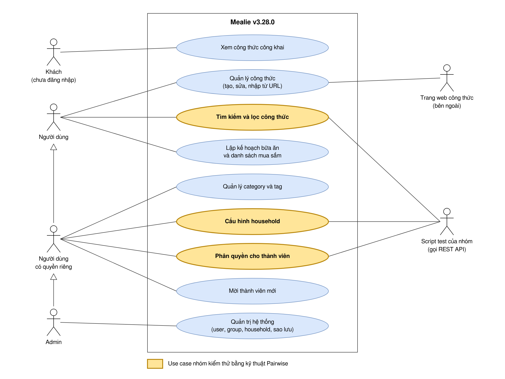
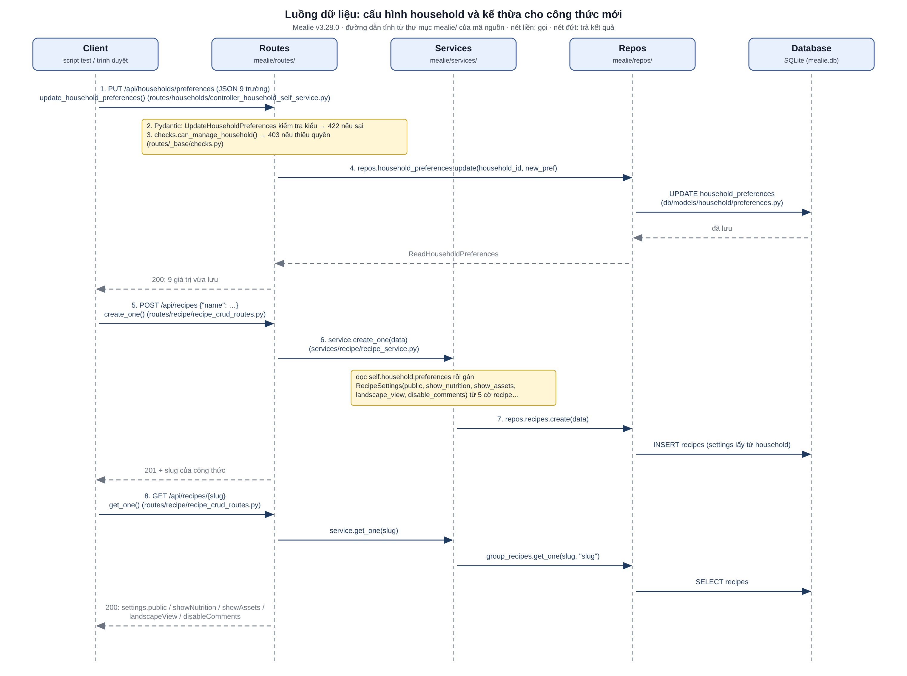
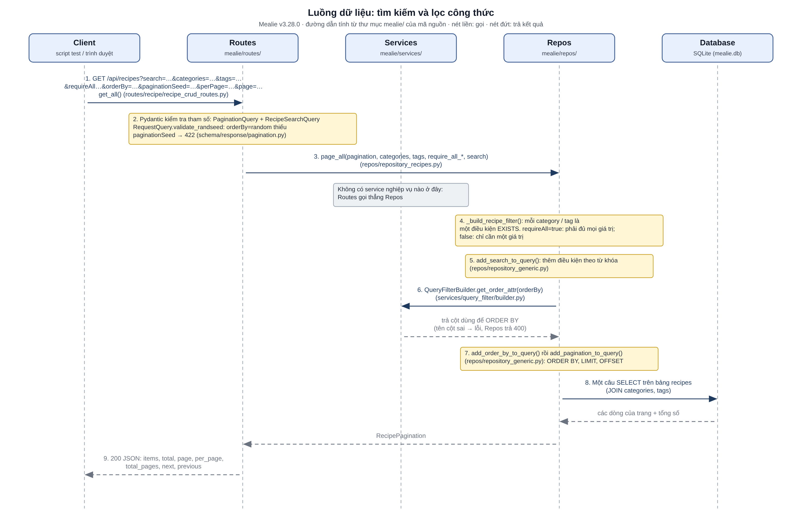
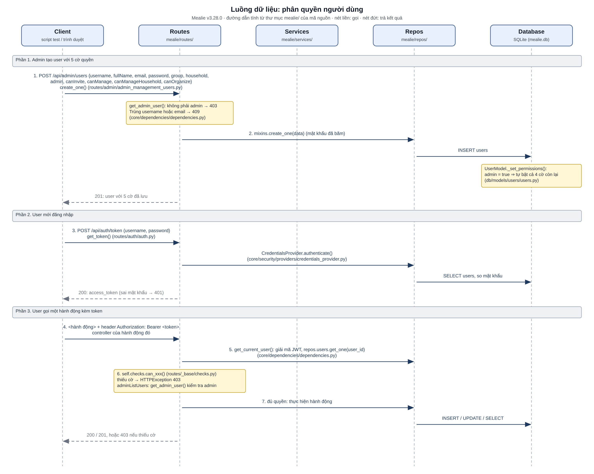

# Mục A. Phân tích hệ thống

Hệ thống được phân tích là Mealie, phiên bản `v3.28.0` (commit `0552eaa4a80031b8572849cca0ed95d07f1be001`). Mọi nhận xét trong mục này đều dựa trên đúng phiên bản đó.

## A.1 Mục tiêu hệ thống

Mealie là một ứng dụng web quản lý công thức nấu ăn, mã nguồn mở (giấy phép AGPL), do người dùng tự cài trên máy hoặc máy chủ của mình. Dự án tự giới thiệu là "a self hosted recipe manager, meal planner and shopping list", tức là gom ba việc vào một chỗ: lưu công thức, lên kế hoạch bữa ăn và lập danh sách đi chợ.

Bài toán Mealie giải quyết khá quen thuộc với một gia đình. Công thức nấu ăn thường nằm rải rác ở nhiều trang web, ảnh chụp, ghi chú. Khi cần lên thực đơn cho cả tuần thì phải tìm lại từng món, rồi tự chép nguyên liệu ra giấy để đi chợ. Mealie cho phép dán đường dẫn của một trang công thức để hệ thống tự lấy tên món, nguyên liệu và các bước về, hoặc nhập tay những công thức của gia đình. Từ kho công thức đó, người dùng xếp món vào từng ngày và tạo danh sách mua sắm dùng chung cho cả nhà.

Người dùng mà Mealie nhắm tới là một gia đình hoặc một nhóm nhỏ dùng chung một bản cài đặt, không phải một dịch vụ công cộng. Vì vậy hệ thống có sẵn cơ chế chia người dùng thành nhóm và hộ gia đình, kèm phân quyền cho từng người.

Các nhóm chức năng chính:

| Nhóm chức năng | Nội dung |
| --- | --- |
| Công thức | Tạo bằng tay, nhập từ URL, nhập từ ứng dụng khác (Nextcloud, Paprika, Tandoor...), sửa, xóa, bình luận, đánh giá, chia sẻ bằng link |
| Tổ chức | Gắn category, tag, dụng cụ cho công thức; gom công thức thành sổ (cookbook) |
| Tìm kiếm | Tìm theo từ khóa, lọc theo category và tag, sắp xếp, phân trang |
| Kế hoạch bữa ăn | Xếp món vào từng ngày, theo từng bữa |
| Danh sách mua sắm | Lập danh sách, thêm nguyên liệu từ công thức |
| Người dùng | Nhiều người dùng, chia theo group và household, phân quyền từng người |
| Quản trị | Quản lý user, group, household, sao lưu và khôi phục dữ liệu |
| REST API | Mọi chức năng trên đều gọi được qua API. Trang `/docs` của bản `v3.28.0` liệt kê 266 thao tác trên 182 đường dẫn |

Về mặt kỹ thuật, Mealie gồm một backend viết bằng Python (FastAPI) cung cấp REST API và một giao diện web viết bằng Vue. Giao diện chỉ là một ứng dụng gọi vào API đó. Đây là lý do nhóm chọn kiểm thử qua API: test gọi đúng vào nơi xử lý nghiệp vụ, không phụ thuộc vào giao diện.

Hai khái niệm riêng của Mealie xuất hiện trong cả ba luồng kiểm thử:

- **Group:** một nhóm lớn dùng chung kho công thức, category và tag. Bản cài mặc định có sẵn group tên `Home`.
- **Household:** một hộ gia đình nằm trong group. Mỗi user thuộc đúng một household. Kế hoạch bữa ăn và danh sách mua sắm là của riêng từng household. Bản cài mặc định có sẵn household tên `Family`. Mỗi household có một bộ cài đặt riêng, trong đó có các giá trị mặc định áp cho công thức mới.

## A.2 Actor

Hệ thống có năm actor chính và một actor phụ.

| Actor | Là ai | Làm được gì |
| --- | --- | --- |
| Khách | Người chưa đăng nhập | Xem công thức được để công khai, hoặc mở công thức qua link chia sẻ |
| Người dùng | Người đã đăng nhập, không có quyền riêng nào | Tạo, sửa, tìm công thức; lập kế hoạch bữa ăn; danh sách mua sắm; sổ công thức; bình luận, đánh giá; tạo API token cho mình |
| Người dùng có quyền riêng | Người dùng được cấp thêm một hoặc nhiều trong 4 quyền | Mọi việc của người dùng, cộng với việc mà quyền đó cho phép (bảng dưới) |
| Admin | Quản trị viên của bản cài đặt | Mọi việc ở trên, cộng với quản lý user, group, household, sao lưu và cài đặt hệ thống |
| Ứng dụng gọi API | Một chương trình gọi REST API thay cho người dùng bằng token | Làm được đúng những gì user cấp token làm được. Script test của nhóm thuộc loại này |
| Trang web công thức (actor phụ) | Trang web bên ngoài | Cung cấp nội dung khi người dùng nhập công thức từ URL |

Bốn quyền riêng mà admin hoặc người quản lý có thể cấp cho một user:

| Quyền (tên trong API) | Cho phép |
| --- | --- |
| `canOrganize` | Tạo, sửa, xóa category và tag |
| `canManageHousehold` | Đổi cài đặt của household |
| `canManage` | Xem danh sách thành viên, đặt quyền cho thành viên khác, đổi cài đặt của group |
| `canInvite` | Tạo lời mời để người mới đăng ký vào household |

Một số điểm rút ra khi đối chiếu với mã nguồn và gọi thử API:

- Bản cài của nhóm tắt tự đăng ký (`ALLOW_SIGNUP: "false"`), nên tài khoản mới chỉ có khi admin tạo hoặc khi có lời mời.
- Khi tạo user với `admin` bật, Mealie tự bật luôn cả 4 quyền riêng. Vì vậy admin luôn làm được mọi việc của người dùng có quyền riêng.
- Người dùng không có quyền nào vẫn tạo được công thức, kế hoạch bữa ăn và danh sách mua sắm. Việc bị chặn là những việc ảnh hưởng tới cả nhóm: gọi API tạo category bị từ chối với mã 403.
- Khách chỉ xem được một công thức khi **cả ba** điều kiện cùng đúng: group không để riêng tư, household không để riêng tư (`privateHousehold` tắt) và công thức được đánh dấu công khai. Mặc định group để riêng tư, nên bản mới cài không cho khách xem gì.
- Link chia sẻ là ngoại lệ: người có link mở được công thức đó dù household đang để riêng tư.

Các quyền được kiểm tra ở tầng API, trong lớp `OperationChecks` của `mealie/routes/_base/checks.py` và hàm `get_admin_user` của `mealie/core/dependencies/dependencies.py`.

## A.3 Use case

Sơ đồ có 9 use case đại diện cho các nhóm chức năng ở A.1. Mũi tên đầu tam giác rỗng giữa các actor là quan hệ kế thừa: Admin làm được mọi việc của người dùng có quyền riêng, người dùng có quyền riêng làm được mọi việc của người dùng. Ba use case tô vàng là phạm vi kiểm thử của nhóm. Actor "Script test của nhóm" ở bên phải là chương trình gọi REST API thay cho người dùng; trên sơ đồ nó chỉ được nối với ba use case mà nhóm kiểm thử.

| Mã | Use case | Actor | Mô tả ngắn | API chính |
| --- | --- | --- | --- | --- |
| UC1 | Xem công thức công khai | Khách | Xem công thức mà không cần đăng nhập, khi group, household và công thức đều để công khai | `GET /api/explore/groups/{group}/recipes` |
| UC2 | Quản lý công thức | Người dùng, trang web công thức | Tạo bằng tay hoặc nhập từ URL, sửa, xóa | `POST /api/recipes`, `POST /api/recipes/create/url` |
| **UC3** | **Tìm kiếm và lọc công thức** | Người dùng | Tìm theo từ khóa, lọc theo category và tag, sắp xếp, phân trang | `GET /api/recipes` |
| UC4 | Lập kế hoạch bữa ăn và danh sách mua sắm | Người dùng | Xếp món vào ngày, lập danh sách đi chợ | `/api/households/mealplans`, `/api/households/shopping/lists` |
| UC5 | Quản lý category và tag | Người dùng có quyền `canOrganize` | Tạo, sửa, xóa category và tag dùng chung trong group | `POST /api/organizers/categories` |
| **UC6** | **Cấu hình household** | Người dùng có quyền `canManageHousehold` | Đổi 9 tùy chọn của household, trong đó 5 tùy chọn là giá trị mặc định cho công thức mới | `PUT /api/households/preferences` |
| **UC7** | **Phân quyền cho thành viên** | Người dùng có quyền `canManage` | Xem thành viên của household và bật, tắt 4 quyền riêng của từng người | `PUT /api/households/permissions` |
| UC8 | Mời thành viên mới | Người dùng có quyền `canInvite` | Tạo lời mời để người mới đăng ký | `POST /api/households/invitations` |
| UC9 | Quản trị hệ thống | Admin | Quản lý user, group, household; sao lưu và khôi phục | `/api/admin/users`, `/api/admin/backups` |

Nhóm chọn UC3, UC6 và UC7 vì cả ba đều là nơi nhiều tham số độc lập gặp nhau trong một lần xử lý, đúng loại bài toán mà kỹ thuật Pairwise nhắm tới:

- **UC3 Tìm kiếm và lọc:** một API nhận cùng lúc 9 tham số (từ khóa, category, tag, hai cờ "bắt buộc đủ", cột sắp xếp, chiều sắp xếp, seed, kích thước trang). Thử hết cần 5.832 tổ hợp hợp lệ.
- **UC6 Cấu hình household:** 9 tùy chọn đi cùng nhau, thử hết cần 1.792 tổ hợp. Kết quả kiểm tra được rõ ràng: công thức tạo sau khi lưu cấu hình phải nhận đúng 5 giá trị mặc định. Luồng này nối UC6 với UC2.
- **UC7 Phân quyền:** 5 cờ (admin và 4 quyền riêng) kết hợp với 6 hành động, tổng cộng 192 tổ hợp. Test không chỉ gọi UC7 mà kiểm tra hệ quả của nó: với mỗi bộ quyền, hệ thống phải cho phép hoặc từ chối đúng các hành động thuộc UC5, UC6, UC7, UC8 và UC9.

Các use case còn lại (UC1, UC2, UC4, UC5, UC8, UC9) nằm ngoài phạm vi, chỉ được dùng tới khi một luồng kiểm thử cần, ví dụ tạo công thức trong luồng household.

## A.4 Cây thư mục và module

_Phần của Hồ Quốc Tiến._

## A.5 Dependency

_Phần của Hồ Quốc Tiến._

## A.6 Luồng dữ liệu của 3 nghiệp vụ

Mỗi sơ đồ dưới đây là sơ đồ tuần tự gồm 5 cột: Client (script test hoặc trình duyệt), Routes, Services, Repos, Database. Mũi tên nét liền là lời gọi, nét đứt là kết quả trả về; trên mũi tên ghi tên hàm thật của Mealie `v3.28.0`, đường dẫn tính từ thư mục `mealie/` của mã nguồn. File nguồn `.drawio` nằm trong `docs/so-do/`.

### A.6.1 Cấu hình household

Dữ liệu vào là 9 tùy chọn dạng JSON gửi tới `PUT /api/households/preferences`. Pydantic (`UpdateHouseholdPreferences`) kiểm tra kiểu dữ liệu, hàm `can_manage_household()` kiểm tra quyền, rồi tầng Repos ghi vào bảng `household_preferences`. Khi người dùng tạo công thức mới, hàm `create_one` trong `recipe_service.py` đọc lại cấu hình này và gán 5 cài đặt mặc định (`public`, `showNutrition`, `showAssets`, `landscapeView`, `disableComments`) cho công thức trước khi lưu vào bảng `recipes`. Hai API khác nhau được nối với nhau qua dữ liệu lưu trong cơ sở dữ liệu, và test của nhóm kiểm tra đúng mối nối này.

### A.6.2 Tìm kiếm và lọc công thức

Dữ liệu vào là các tham số trên URL của `GET /api/recipes` (từ khóa, category, tag, `requireAll...`, `orderBy`, `orderDirection`, `paginationSeed`, `perPage`, `page`). Tham số được Pydantic kiểm tra ở lớp `RequestQuery`: `orderBy=random` mà thiếu `paginationSeed` bị từ chối với mã 422. Luồng này không có service nghiệp vụ: hàm `get_all` gọi thẳng `page_all` của tầng Repos, nơi dựng điều kiện lọc category và tag, điều kiện tìm kiếm, sắp xếp và phân trang thành một câu `SELECT` trên bảng `recipes`. Kết quả trả về là JSON phân trang gồm `items`, `total`, `page`, `per_page`, `total_pages`.

### A.6.3 Phân quyền người dùng

Admin tạo user bằng `POST /api/admin/users` kèm 5 cờ quyền; `get_admin_user()` kiểm tra người gọi là admin, và khi lưu, `_set_permissions` tự bật cả 4 cờ còn lại nếu `admin` là true. Quyền được lưu trong bảng `users`. User đăng nhập để nhận token JWT; mỗi lần gọi một hành động, `get_current_user()` giải mã token và đọc user từ cơ sở dữ liệu, sau đó controller của hành động gọi `self.checks.can_xxx()` trong `OperationChecks`. Thiếu cờ tương ứng thì Mealie trả 403, đủ cờ thì thực hiện hành động và trả 200 hoặc 201.
