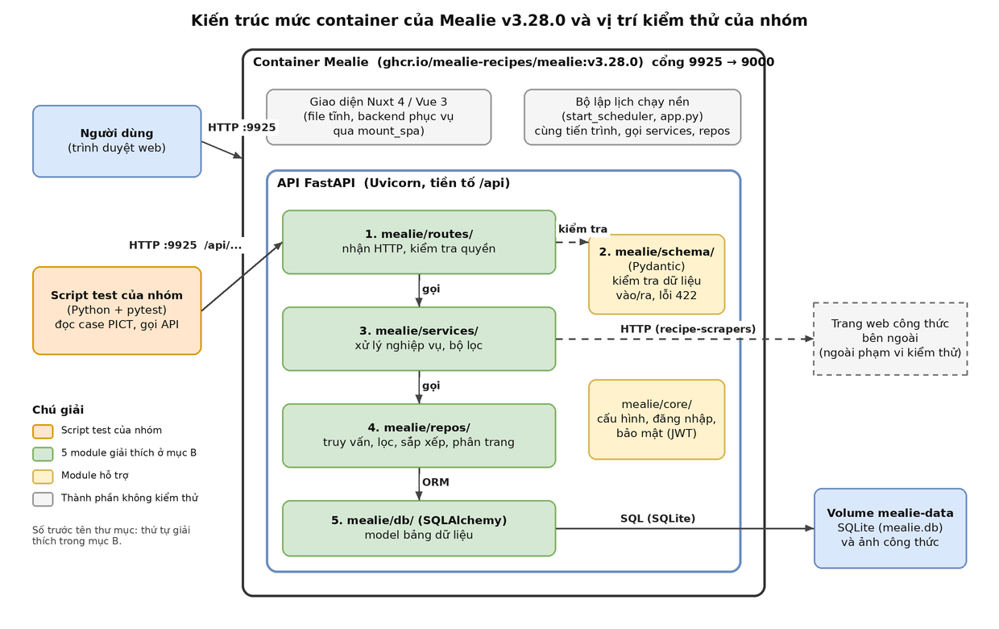

# Mục B. Kiến trúc hệ thống

Phiên bản phân tích: Mealie `v3.28.0`, commit `0552eaa4a80031b8572849cca0ed95d07f1be001`. Mọi tên file và tên hàm dưới đây đã được mở ra đối chiếu trong mã nguồn của đúng tag này.

## B.1 Sơ đồ kiến trúc

File nguồn: [`so-do/kien-truc.drawio`](so-do/kien-truc.drawio) (mở bằng https://app.diagrams.net).

**Cách đọc sơ đồ.** Người dùng mở trình duyệt, gọi HTTP tới cổng 9925; Docker chuyển vào cổng 9000 của container Mealie. Giao diện Nuxt/Vue là file tĩnh do chính backend phục vụ, còn dữ liệu được lấy qua API FastAPI dưới đường dẫn `/api`. Một request API đi qua bốn tầng xếp dọc: `routes` nhận request và kiểm tra quyền, `services` xử lý nghiệp vụ, `repos` truy vấn, `db` ánh xạ sang bảng SQLite; dữ liệu cuối cùng nằm trong volume `mealie-data` (file SQLite và ảnh công thức). `schema` kiểm tra dữ liệu vào ra ở tầng routes, `core` lo cấu hình và đăng nhập. **Script test của nhóm (khối màu cam) đi thẳng vào API ở cổng 9925, không qua giao diện**, nên toàn bộ phần kiểm thử nằm ở tầng `routes` trở xuống. Phần Mealie tải công thức từ trang web ngoài khi nhập URL nằm ngoài phạm vi kiểm thử.

## B.2 Các module liên quan tới kiểm thử

Ba luồng nhóm kiểm thử đi qua các module như sau:

| Luồng | Routes | Schema | Services, kiểm tra | Repos, DB |
| --- | --- | --- | --- | --- |
| 1. Tìm kiếm và lọc công thức | `routes/recipe/recipe_crud_routes.py`, hàm `get_all` | `schema/response/pagination.py` | `services/query_filter/` | `repos/repository_generic.py` (`add_order_by_to_query`), `repos/repository_recipes.py` (`page_all`) |
| 2. Cấu hình household | `routes/households/controller_household_self_service.py` (`update_household_preferences`); `routes/recipe/recipe_crud_routes.py` (`create_one`) | `schema/household/household_preferences.py` | `services/recipe/recipe_service.py` (`create_one`) | `db/models/household/preferences.py` |
| 3. Phân quyền người dùng | controller của từng hành động | `schema/household/household_permissions.py` (`SetPermissions`) | `routes/_base/checks.py` (`OperationChecks`); `core/dependencies/dependencies.py` (`get_admin_user`) | `db/models/users/users.py` (`_set_permissions`) |

### B.2.1 Routes (`mealie/routes/`)

Đây là tầng API, và cũng là **cửa vào duy nhất của script test**. Mỗi thư mục con là một nhóm API; `routes/__init__.py` gom tất cả vào một `APIRouter(prefix="/api")`. Trong mỗi controller, hàm xử lý chỉ làm ba việc: nhận tham số đã được kiểm tra, gọi hàm kiểm tra quyền, rồi chuyển việc cho service hoặc repo. Hàm quan trọng nhất cho luồng 1 là `get_all` trong `routes/recipe/recipe_crud_routes.py` (GET `/api/recipes`): nó nhận `PaginationQuery` cùng các tham số `categories`, `tags`, `tools`, `foods`, `households`, `requireAllCategories`, `requireAllTags`, rồi gọi `page_all` của repo. Với luồng 2, hàm `update_household_preferences` trong `controller_household_self_service.py` (PUT `/api/households/preferences`) gọi `self.checks.can_manage_household()` rồi cập nhật cấu hình. Với luồng 3, mỗi controller gọi một phép kiểm tra tương ứng ngay đầu hàm, ví dụ `set_member_permissions` gọi `can_manage()`.

### B.2.2 Schema (`mealie/schema/`)

Schema định nghĩa hình dạng dữ liệu vào và ra bằng Pydantic, nên đây là **nguồn thật để lập model PICT**: tên tham số, kiểu, giá trị mặc định đều đọc ra từ đây. `schema/household/household_preferences.py`, lớp `UpdateHouseholdPreferences`, liệt kê đúng 9 trường của luồng household (`private_household`, `show_announcements`, `lock_recipe_edits_from_other_households`, `first_day_of_week`, `recipe_public`, `recipe_show_nutrition`, `recipe_show_assets`, `recipe_landscape_view`, `recipe_disable_comments`; JSON viết kiểu camelCase). `schema/response/pagination.py` có lớp `RequestQuery` với `order_by`, `order_direction`, `pagination_seed` và hàm kiểm tra `validate_randseed`: khi `order_by == "random"` mà không có `pagination_seed` thì ném lỗi, đây là **ràng buộc thật** được đưa vào model tìm kiếm và là cơ sở của test âm. `PaginationQuery` thêm `page` (mặc định 1) và `per_page` (mặc định 50). Schema cũng là nơi sinh ra lỗi 422 mà script test sẽ gặp khi gửi dữ liệu sai.

### B.2.3 Services (`mealie/services/`)

Services chứa logic nghiệp vụ nằm giữa API và cơ sở dữ liệu. Hai nơi liên quan tới nhóm. Thứ nhất, `services/recipe/recipe_service.py`, hàm `create_one`: khi tạo công thức mới bằng `CreateRecipe`, hàm đọc `self.household.preferences` và gán `RecipeSettings` (`public`, `show_nutrition`, `show_assets`, `landscape_view`, `disable_comments`) từ các cờ `recipe_*` của household. Đây chính là chỗ **luồng 2 có kết quả quan sát được**: đổi cấu hình household, tạo công thức mới, rồi kiểm tra `settings` của công thức. Thứ hai, `services/query_filter/` (`builder.py`, `operators.py`, `keywords.py`) phân tích chuỗi bộ lọc `queryFilter` thành điều kiện truy vấn; luồng 1 đi qua đây khi có bộ lọc. Ngoài hai nơi này, thư mục còn có `scheduler/` (các tác vụ nền chạy theo giờ, được `start_scheduler` trong `app.py` đăng ký) và `scraper/` (nhập công thức từ URL), cả hai nằm ngoài phạm vi kiểm thử.

### B.2.4 Repos (`mealie/repos/`)

Repos là tầng truy vấn: mỗi repository bọc một bảng và cung cấp các thao tác chung. `repos/repository_generic.py` là lớp gốc; hàm `add_order_by_to_query` quyết định cách sắp xếp: nếu `order_by == "random"` thì **xáo thứ tự ngoài cơ sở dữ liệu** bằng `random.seed(pagination_seed)` rồi `random.shuffle`, để kết quả ổn định giữa các trang (và vì không phải DB nào cũng đặt được seed ngẫu nhiên); với các giá trị khác thì tách `orderBy` theo dấu phẩy, hỗ trợ cú pháp `cột:chiều`, và trả lỗi 400 nếu cột không hợp lệ. Hàm `page_all` cùng lớp tính offset, tổng số trang theo `page` và `per_page` (`per_page = -1` nghĩa là lấy tất cả). Riêng công thức có `repos/repository_recipes.py`, hàm `page_all` nhận `categories`, `tags`, `tools`, `foods`, `households` cùng các cờ `require_all_*` và `search`. Luồng 1 của nhóm kiểm thử chủ yếu ở đây: các tổ hợp lọc, sắp xếp, phân trang đều được thực thi tại tầng này.

### B.2.5 DB (`mealie/db/`)

DB chứa model bảng dữ liệu bằng SQLAlchemy trong `db/models/` và phần khởi tạo (`db_setup.py` tạo kết nối, `init_db.py` chạy nâng cấp Alembic khi khởi động và tạo group, household, user mặc định lần đầu). Hai model quan trọng với nhóm: `db/models/household/preferences.py`, bảng lưu 9 cờ cấu hình household của luồng 2; và `db/models/users/users.py`, hàm `_set_permissions`: **nếu user là admin thì tự bật cả bốn cờ `can_manage_household`, `can_manage`, `can_invite`, `can_organize` (và `advanced`)**, ngược lại giữ đúng giá trị được truyền vào. Đây là sự tương tác giữa hai tham số mà pairwise sinh ra để bắt, và là điều phải nhớ khi viết kết quả mong đợi cho luồng 3: một hành động thành công khi user có cờ tương ứng *hoặc* là admin. DB mặc định là SQLite (`DB_ENGINE = "sqlite"`), nên khi phân tích nguyên nhân lỗi có thể mở thẳng file `mealie.db` trong volume để đối chiếu.

### Module hỗ trợ: Core (`mealie/core/`)

Không nằm trong 5 module chính nhưng luồng 3 cần: `core/dependencies/dependencies.py`, hàm `get_admin_user`, trả 403 nếu `current_user.admin` là sai, và `routes/_base/checks.py`, lớp `OperationChecks`, có bốn hàm `can_manage_household`, `can_manage`, `can_invite`, `can_organize`, mỗi hàm ném `HTTPException` 403 nếu user thiếu cờ. Thiếu đăng nhập thì trả 401. `core/settings/settings.py` giữ tài khoản mặc định `changeme@example.com` / `MyPassword` và các biến môi trường.

## B.3 Điểm đặt kiểm thử

| Câu hỏi của thầy | Trả lời |
| --- | --- |
| Nhóm kiểm thử ở tầng nào? | Tầng API (`routes`), bằng HTTP tới cổng 9925; không kiểm thử qua giao diện |
| Vì sao không qua giao diện? | Chạy nhanh, ổn định, tự động hóa được hàng nghìn case; giao diện chỉ dùng để demo |
| Đầu vào của test lấy từ đâu? | Từ `schema/` (tham số và giá trị hợp lệ), qua model PICT |
| Kết quả mong đợi xác định từ đâu? | Từ code ở `services/`, `repos/`, `core/` và `db/` (ví dụ `create_one`, `add_order_by_to_query`, `_set_permissions`) |
| Phần nào không kiểm thử? | Giao diện `frontend/`, nhập công thức từ URL (`scraper/`), bộ lập lịch, nâng cấp `alembic/` |
