# Mục C Môi trường và cách chạy hệ thống

Phần C do Nguyễn Phú Quý (2312731) phụ trách. Nhóm chạy Mealie v3.28.0 bằng Docker và chuẩn bị dữ liệu cho ba luồng: tìm kiếm công thức, cấu hình household và phân quyền người dùng.

## C.1 Môi trường và phiên bản

| Thành phần | Giá trị ghi nhận |
| --- | --- |
| Hệ điều hành | Windows 11 Home Single Language, 25H2, version 10.0.26200, build 26200 |
| Docker Desktop | 4.91.0.239619 |
| Docker CLI | 29.8.0, build 88096ef |
| Docker Compose | v5.5.1 |
| Mealie từ API `/api/app/about` | v3.28.0 |
| Tag mã nguồn đã chốt | `v3.28.0` |
| Commit mã nguồn theo README | `0552eaa4a80031b8572849cca0ed95d07f1be001` |
| Image | `ghcr.io/mealie-recipes/mealie:v3.28.0` |
| Digest image thực tế | `sha256:8b02290f4d1806f02acac6f25f6d48a3c965612fda1f8e914d5af533276f8688` |
| DB | SQLite, `/app/data/mealie.db` |
| Web và API docs | `http://localhost:9925`, `http://localhost:9925/docs` |

Nhóm dùng tag và SHA mã nguồn trong README để đọc code. Khi chạy Docker, nhóm kiểm tra thêm phiên bản qua API và digest của image. Python 3.10 trở lên dùng để nạp dữ liệu, không cần cài backend Mealie trên Windows.

Đầu ra lệnh thực tế nằm trong [C-environment.json](evidence/C-environment.json).

Ảnh C-01 cần bổ sung: cửa sổ Command Prompt sau khi chạy `docker --version` và `docker compose version`.

## C.2 Cài đặt và lệnh chạy

### Chuẩn bị máy

1. Cài Git for Windows và Docker Desktop từ trang chính thức; dùng Linux containers và WSL 2 theo yêu cầu trình cài. Khởi động lại nếu cần.
2. Mở Docker Desktop, đợi engine sẵn sàng. Kiểm tra `docker --version`, `docker compose version`, `docker info`.
3. Clone repo và chạy tại thư mục chứa Compose:

```bat
git clone https://github.com/2312770-LeNhatTien/Nhom22_ktpm-mealie-pairwise.git
cd Nhom22_ktpm-mealie-pairwise
docker compose up -d
docker compose ps
```

Lần đầu cần mạng để tải image. Khi container healthy, mở `http://localhost:9925`. Nếu chưa lên, xem `docker compose logs --tail 100 mealie`. Cấu hình này chạy image phát hành sẵn, không cần build mã nguồn Mealie.

### File Compose

Nội dung khớp [docker-compose.yml](../docker-compose.yml):

```yaml
services:
  mealie:
    image: ghcr.io/mealie-recipes/mealie:v3.28.0
    container_name: mealie
    ports:
      - "9925:9000"
    volumes:
      - mealie-data:/app/data/
    environment:
      ALLOW_SIGNUP: "false"
      PUID: 1000
      PGID: 1000
      TZ: Asia/Ho_Chi_Minh
      BASE_URL: http://localhost:9925

volumes:
  mealie-data:
```

`image` cố định tag. `ports` nối cổng 9925 của máy vào 9000 của container. Volume giữ SQLite và file dữ liệu khi dừng/tạo lại container. Docker thường thêm tiền tố project vào tên volume thực tế. `container_name` đặt tên container là `mealie`.

| Lệnh | Tác dụng |
| --- | --- |
| `docker compose up -d` | Tạo/chạy container nền |
| `docker compose ps` | Xem trạng thái và ánh xạ cổng |
| `docker compose logs --tail 100 mealie` | Xem log gần nhất |
| `docker compose stop` / `docker compose start` | Dừng/chạy lại, giữ dữ liệu |
| `docker compose down` | Gỡ container/network, giữ named volume |
| `docker compose down -v` | Xóa cả volume và dữ liệu; chỉ dùng khi chủ động reset, đã giữ dữ liệu cần thiết |

Ảnh C-02 và C-03 cần bổ sung: cửa sổ Command Prompt sau khi chạy `docker compose up -d` và `docker compose ps`. C-03 cần thấy trạng thái healthy và cổng 9925.

### Thiết lập lần đầu

Trên máy mới, đăng nhập bằng `changeme@example.com` / `MyPassword`, hoàn tất wizard:

| Bước | Giá trị |
| --- | --- |
| Account Details | Username `nhom22`, Full Name `Nhom 22`, Email `nhom22@example.com`, Password `Nhom22@Mealie` |
| Site Settings | Tắt Enable Advanced Content, tắt Enable Public Access, bật Use Seed Data |
| AI Providers | Bỏ qua |
| Summary | Kiểm tra và hoàn tất |

Đăng xuất rồi đăng nhập bằng `nhom22@example.com` / `Nhom22@Mealie`; phải vào thẳng trang chủ. Đây là tài khoản lab theo README.

Nhóm chụp ba bước thiết lập trên bản Mealie riêng ở cổng 9926, dùng container `mealie-onboarding` và volume mới `mealie-onboarding-data`. Cách này cho phép xem lại trình thiết lập mà vẫn giữ bộ dữ liệu kiểm thử ở cổng 9925.

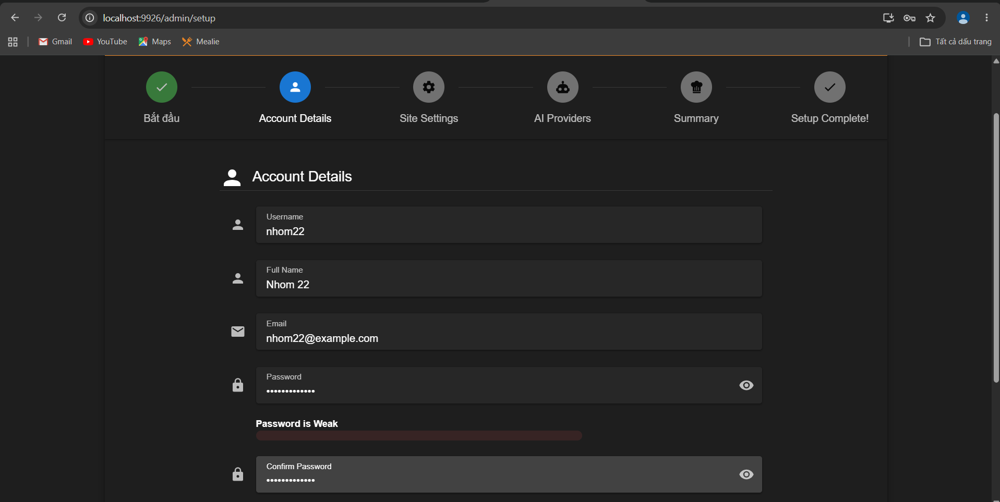

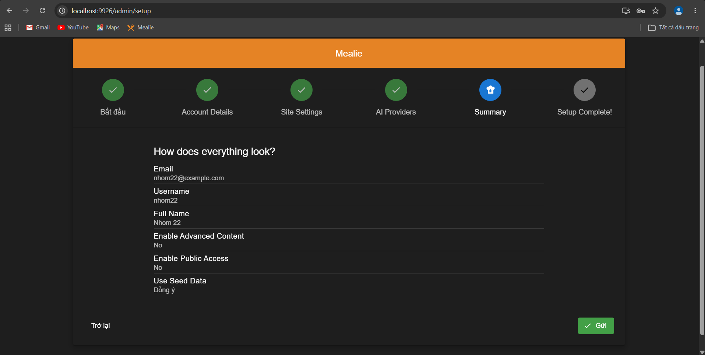

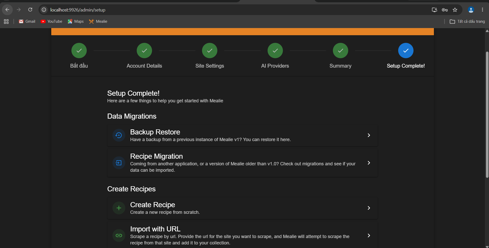

Sau khi hoàn tất thiết lập, nhóm đăng nhập lại bằng tài khoản mới. API trên cổng 9926 trả 200; `/api/users/self` trả đúng admin `nhom22`, họ tên `Nhom 22`, email `nhom22@example.com`, group `Home`, household `Family`. Kết quả lưu tại [C-onboarding-verification.json](evidence/C-onboarding-verification.json).

`Use Seed Data` trong wizard là lựa chọn nạp dữ liệu có sẵn của Mealie, khác với bộ 12 công thức của nhóm ở C.4. Sau wizard, API trên bản phụ ghi nhận 0 công thức; bộ 12 món cần được nạp riêng bằng script của nhóm.

Để kiểm tra wizard trên một volume mới riêng, có thể dùng lệnh đã thực hiện cho bộ ảnh này (PowerShell ở thư mục bất kỳ):

```powershell
docker run -d --name mealie-onboarding -p 127.0.0.1:9926:9000 -v mealie-onboarding-data:/app/data/ -e ALLOW_SIGNUP=false -e TZ=Asia/Ho_Chi_Minh -e BASE_URL=http://localhost:9926 ghcr.io/mealie-recipes/mealie:v3.28.0
```

Tên container/volume phải chưa được dùng nếu muốn bắt đầu từ môi trường sạch; chạy lại với volume đã thiết lập sẽ giữ tài khoản cũ và không mở wizard lần đầu. Sau khi lấy ảnh, có thể dừng bản phụ bằng `docker stop mealie-onboarding`; không cần xóa volume của bản chính.

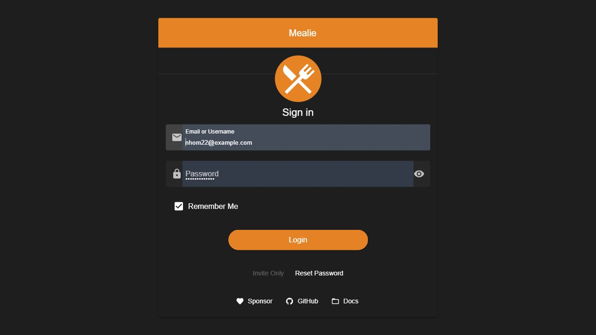

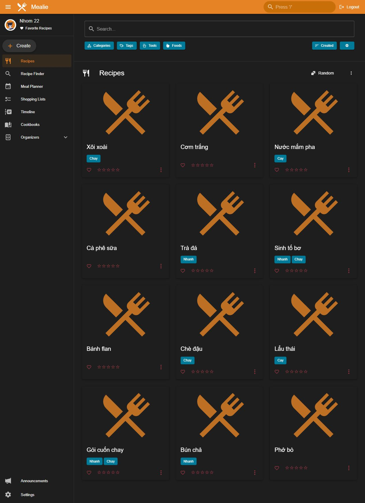

## C.3 Cơ sở dữ liệu và service

Compose chỉ có service `mealie`, không cần PostgreSQL hay Redis riêng. File SQLite đã xác nhận tại `/app/data/mealie.db` trong container, dưới volume `/app/data/`. Dữ liệu ứng dụng và ảnh cũng được giữ trong volume.

| Biến | Giá trị | Ý nghĩa |
| --- | --- | --- |
| `ALLOW_SIGNUP` | `false` | Tắt tự đăng ký; admin tạo user lab |
| `PUID` | `1000` | UID sử dụng trong container |
| `PGID` | `1000` | GID sử dụng trong container |
| `TZ` | `Asia/Ho_Chi_Minh` | Múi giờ ứng dụng |
| `BASE_URL` | `http://localhost:9925` | Địa chỉ gốc tạo link |

Nếu cổng 9925 bị chiếm, đổi mapping thành `9926:9000`, đổi `BASE_URL` tương ứng và địa chỉ truy cập/script.

## C.4 Dữ liệu mẫu và cách chạy lại

Bộ dữ liệu gồm admin `nhom22`, user `khongquyen`/`duquyen`, 3 category, 3 tag và 12 công thức. Bảng tên, nhãn, quyền và kết quả lọc nằm trong [seed-data.md](seed-data.md). [Inventory](evidence/C-seed-inventory.json) ghi ID thực tế; UUID khác nhau trên mỗi máy.

Sau khi thiết lập admin, chạy từ gốc repo:

```bat
python scripts\chuan_bi_muc_c.py seed
python scripts\chuan_bi_muc_c.py verify
```

Chỉ cần Python 3.10 trở lên và thư viện chuẩn. `seed` nạp phần thiếu, không tạo trùng/ghi đè dữ liệu xung đột. `verify` chạy 16 bước API, tạo/xóa dữ liệu tạm, đổi rồi khôi phục household/quyền user. Không chạy cùng test/demo khác. Mặc định dùng `http://localhost:9925`; thêm `--base-url http://localhost:9926` khi đổi cổng. Script chỉ cho phép loopback, kiểm tra version v3.28.0, không lưu token/mật khẩu trong log.

Kết quả thành công:

```text
PASS: 16 bước xác minh; 3 luồng; đã khôi phục household, quyền user và xóa dữ liệu tạm.
```

Đây là kiểm tra vận hành mục C, chưa phải kết quả chạy toàn bộ test Pairwise mục F/G.

## C.5 Bằng chứng ba luồng nghiệp vụ

Nhóm kiểm tra từng luồng bằng dữ liệu ở C.4. Các ảnh dưới đây ghi lại thao tác và kết quả trên Mealie; kết quả kiểm tra tự động lưu trong [C-api-verification.json](evidence/C-api-verification.json).

### Tìm kiếm và lọc

Tại `/g/home`, chọn Categories → Món chính: từ 12 còn 5 công thức. Thêm Tags → Chay: còn Gỏi cuốn chay và Xôi xoài. API kiểm tra thêm category OR/AND, tag AND và thứ tự tên tăng/giảm.


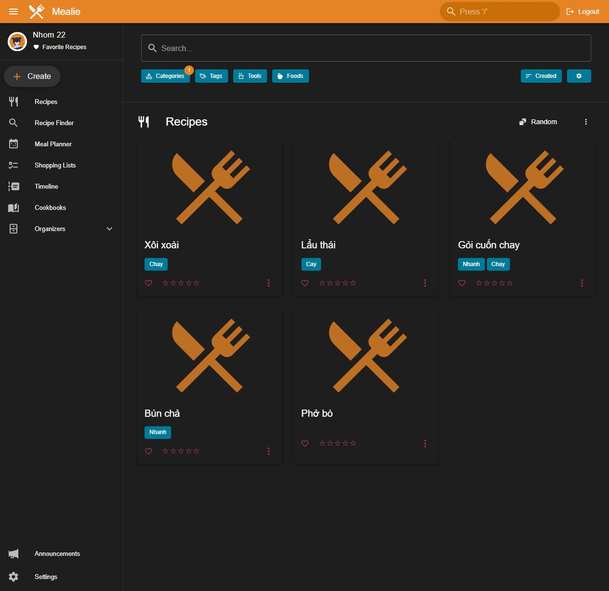

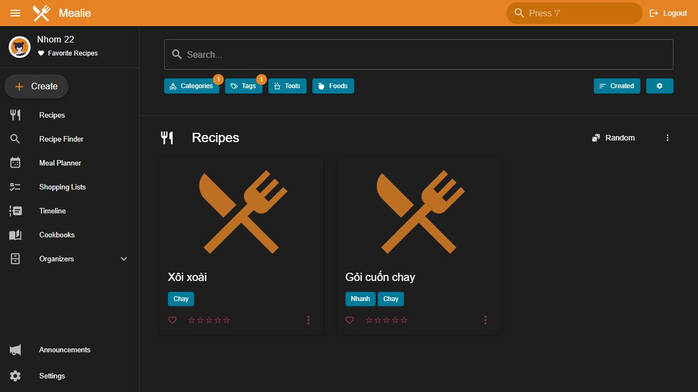

### Cấu hình household

Vào `/household`, ghi cấu hình cũ. Bật Show nutrition information và Disable users from commenting on recipes, bấm Update. Tạo `Demo mục C`, mở Settings: Show Nutrition Values và Disable Comments đều bật. Phải tạo công thức mới sau khi lưu household để chứng minh kế thừa.

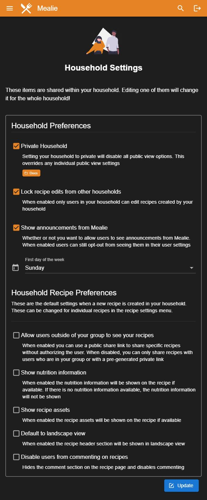

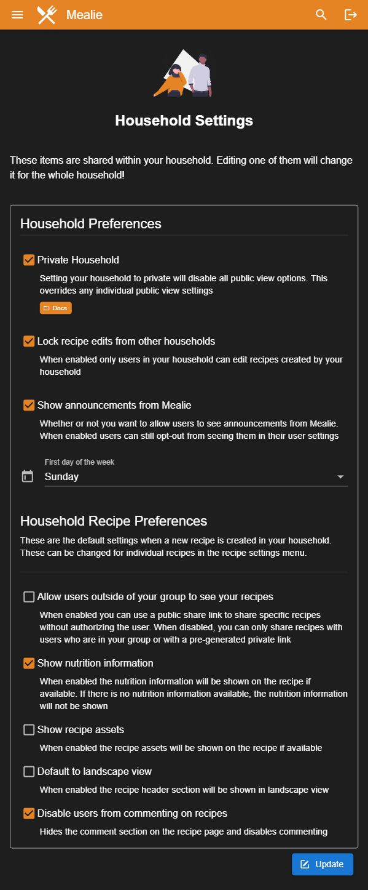

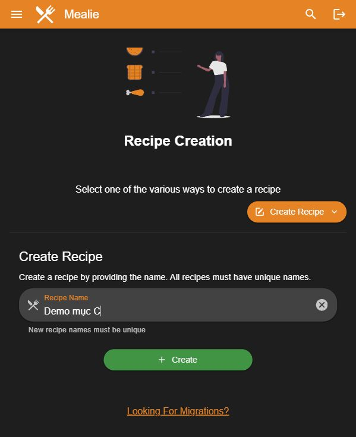

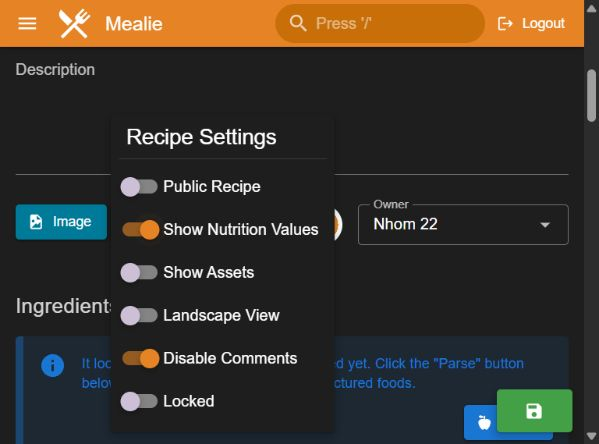

API kiểm tra đủ 5 ánh xạ: `recipePublic → public`, `recipeShowNutrition → showNutrition`, `recipeShowAssets → showAssets`, `recipeLandscapeView → landscapeView`, `recipeDisableComments → disableComments` trong `settings`. Sau chụp đã xóa công thức demo, khôi phục hai cờ về false như ban đầu.

### Phân quyền

User `khongquyen` có admin=false và bốn quyền false. Trong Swagger tại `/docs`, dùng Authorize để đăng nhập `khongquyen@example.com`, mở `POST /api/organizers/categories`, bấm Try it out và nhập `{"name":"C22 Swagger Permission"}`. Lần đầu gọi trả 403.

Ở một tab Swagger khác, đăng nhập admin `nhom22@example.com`, gọi `PUT /api/households/permissions` với `userId` của `khongquyen`, chỉ đặt `canOrganize=true`, ba quyền còn lại false. Quay về tab user và Execute lại cùng request: API trả 201, tạo được category. Nhóm xóa category tạm và trả `canOrganize` về false sau khi chụp.

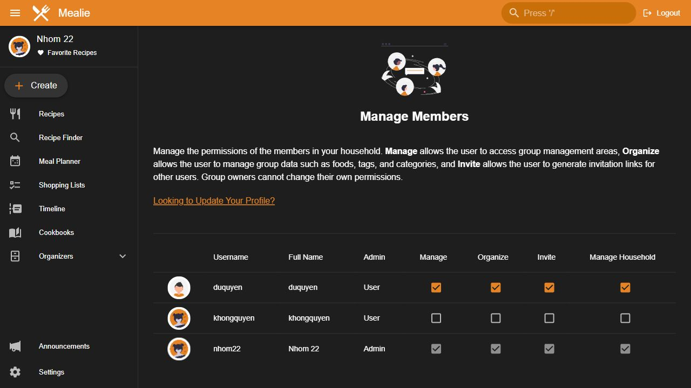

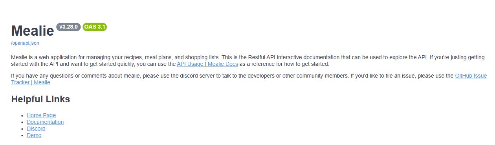

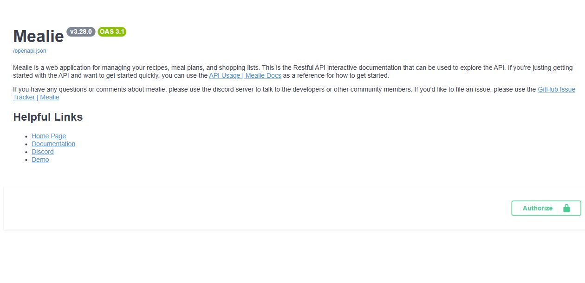

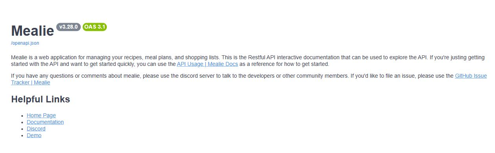

Ba ảnh C-31 đến C-33 ghi kết quả Server response trong Swagger: 403, cấp quyền 200 và tạo category 201. Khung ảnh giữ Request URL và response, bỏ phần cURL có token đăng nhập. [Log kiểm tra tự động](evidence/C-api-verification.json) lưu riêng 16 bước và kết quả khôi phục dữ liệu.

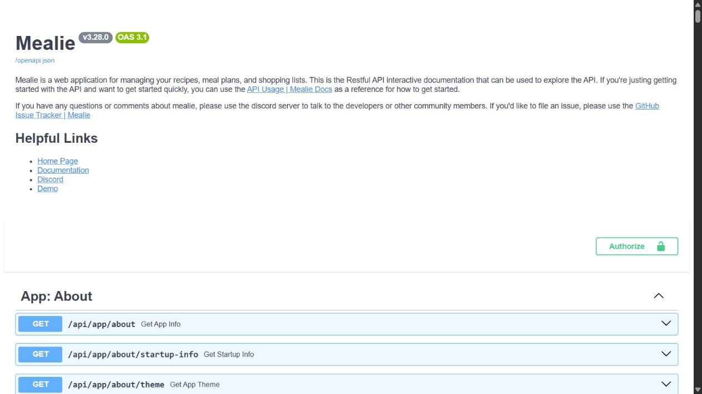

## C.6 Lỗi và cách xử lý

| Vướng mắc khi thiết lập/chạy | Nguyên nhân | Cách xử lý và kết quả |
| --- | --- | --- |
| Đăng nhập bằng tài khoản mặc định thì mở trình thiết lập | Mealie cần cấu hình tài khoản admin lần đầu | Điền tài khoản theo C.2, làm hết các bước rồi đăng nhập lại. Bản cổng 9926 vào được hệ thống bằng admin nhóm, API đăng nhập trả 200. |
| Script báo `Sai phiên bản Mealie: develop` trên bản chạy từ mã nguồn | Bản mã nguồn báo version `develop`, trong khi script kiểm tra đúng bản phát hành `v3.28.0` | Khi đọc chéo, người kiểm tra tạm bỏ điều kiện version: seed chạy hai lần không trùng và verify đạt 16 bước. Với môi trường nộp bài, dùng image v3.28.0 theo Compose và giữ kiểm tra phiên bản trong script. |

Nhóm mới ghi nhận các vướng mắc trên trong lúc thiết lập và đọc chéo. Các lỗi cài đặt khác sẽ được bổ sung khi thành viên gửi hiện tượng và cách xử lý thực tế.
